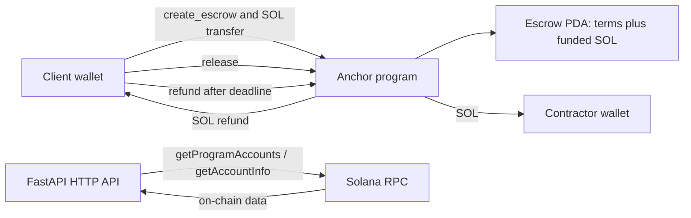

# ProofDock

**Rust/Anchor + Python/FastAPI | Solana SOL milestone escrow | Development MVP (2026)**

ProofDock is an educational, Web3-style escrow prototype for freelancers and contractors. A client deposits SOL against a single milestone, identifies the contractor, commits to off-chain terms using a SHA-256 hash, and sets a deadline. The client can release the funds to the contractor; after the deadline, the client may reclaim them. Each completed or expired escrow is closed, returning rent to the client.

> **Maturity:** Prototype. The Python tests run locally with mocked Solana RPC. The Rust/Anchor contract and TypeScript integration tests require the Solana/Anchor toolchain and a local validator; deployment, audit, and mainnet suitability have **not** been established.

## Technology

- **On-chain:** Rust, Anchor 1.2.1, Solana program-derived addresses (PDAs), system program CPI, rent-aware lamport accounting.
- **Backend:** Python 3.11+, FastAPI, Pydantic v2, HTTPX, strict base58/address and Anchor/Borsh account decoding.
- **Testing:** pytest + mocked RPC, Rust unit tests, TypeScript Anchor local-validator scenarios.
- **Security posture:** client-only release/refund authority, deterministic address derivation, account ownership checks, checked arithmetic, deadline boundaries, no private keys in the HTTP service.

## Core design



### Smart contract instructions

| Instruction | Authorized signer | State transition |
| --- | --- | --- |
| `create_escrow(id, amount, deadline, metadata_hash)` | Client | Transfer SOL into newly created PDA and record immutable terms |
| `release()` | Original client | Pay exact escrow amount to original contractor, close PDA, return rent |
| `refund_expired()` | Original client, once expired | Close PDA and return deposit plus rent to the client |

**Important:** The client controls release. The contractor cannot withdraw unilaterally. This is a *client-authorized escrow prototype*, not a trustless arbitration or dispute-resolution protocol.

### Python API (read-only)

| Endpoint | Purpose |
| --- | --- |
| `GET /health` | Liveness probe |
| `GET /v1/escrows?client=<BASE58>` | All currently funded milestones for a client |
| `GET /v1/escrows/{account_address}` | Retrieve one currently funded escrow |

The backend never holds signing keys. Released/refunded accounts are closed and therefore no longer appear in account queries. A historical event indexer is a future feature.

## Running the Python tests and API

```bash
cd services/api
python -m venv .venv
source .venv/bin/activate
python -m pip install -e '.[dev]'
pytest -q
uvicorn app.main:app --host 127.0.0.1 --port 8000 --reload
# Open http://127.0.0.1:8000/docs
```

By default, API calls target `http://127.0.0.1:8899` (local Solana RPC). Without a validator and deployed program, `/health` works but escrow lookups cannot return live data. The tests use deterministic mocked accounts and do not need a validator.

## Building and testing the Rust/Anchor program

Use **Rust 1.89+**, **Anchor CLI 1.2.1**, **Solana CLI 4.1.2**, and **Node 20.18+**. AVM is the recommended way to select Anchor 1.2.1; see the official docs. These versions target Anchor v1, not the separate v2 release candidates.

```bash
# Prerequisites: cargo, solana-keygen, anchor, npm; a local funded Solana wallet
mkdir -p target/deploy
# Generates a NEW program keypair locally. Never commit the file.
solana-keygen new --no-bip39-passphrase --force -o target/deploy/proofdock-keypair.json
anchor keys sync
anchor build
npm install
anchor test
```

`anchor keys sync` replaces the development placeholder program ID with your newly generated program public key. Set `PROOFDOCK_PROGRAM_ID` in `services/api/.env` (or as an exported environment variable) to the deployed key; do not commit `.env` or keypairs. No funds or private keys are included in this repository.

## Current validation

- Python: **29 pytest tests passing** in the build environment used to create this scaffold.
- Rust: 5 unit-test scenarios authored but **not executed** in that environment (Rust/cargo unavailable).
- Anchor integration: local-validator scenarios authored but **not executed** in that environment (Anchor/Solana toolchains unavailable).
- Deployment: none. Contract has not been audited. Do not use with real funds.

## Repository layout

```
programs/proofdock/src/lib.rs    Anchor instructions, state, constraints, events, errors
services/api/app/               FastAPI routes, RPC transport, account codec
services/api/tests/             Python unit and API tests
tests/proofdock.ts              Local-validator lifecycle integration tests
docs/ARCHITECTURE.md            Account layout and threat model
docs/ROADMAP.md                 Planned milestones and acceptance criteria
.github/workflows/ci.yml        Python/Rust CI checks
```

## Development / history

This is a **newly rebuilt 2026 portfolio prototype**, not a recovered 2022 repository. Git commits correspond to actual work sessions and should use their real timestamps. The implementation is intended to be a demonstrable, discussable code sample with tests and clearly labeled limitations.

See [Architecture & threat model](docs/ARCHITECTURE.md), [Roadmap](docs/ROADMAP.md), and [Security notes](SECURITY.md).

MIT licensed. Educational use only.
