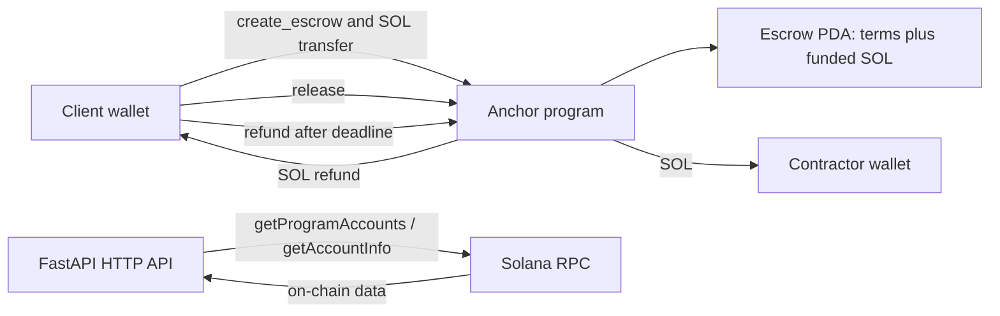

# ProofDock

**Rust/Anchor + Python/FastAPI | SOL and classic SPL-token escrow | Development MVP (2026)**

ProofDock is an educational, Web3-style escrow prototype for freelancers and contractors. A client deposits SOL against a single milestone, identifies the contractor, commits to off-chain terms using a SHA-256 hash, and sets a deadline. The client can release funds to the contractor. Both parties must sign an ordinary refund after the deadline; either party can file a dispute for a preselected independent arbitrator to resolve. Classic SPL-token escrows follow the same model. Each completed or expired escrow is closed, returning rent to the client.

> **Maturity:** Prototype. The Python tests run locally with mocked Solana RPC. The Rust/Anchor contract and TypeScript integration tests require the Solana/Anchor toolchain and a local validator; deployment, audit, and mainnet suitability have **not** been established.

## Technology

- **On-chain:** Rust, Anchor 1.2.1, Solana program-derived addresses (PDAs), system program CPI, rent-aware lamport accounting.
- **Backend:** Python 3.11+, FastAPI, Pydantic v2, HTTPX, strict base58/address and Anchor/Borsh account decoding.
- **Testing:** pytest + mocked RPC, Rust unit tests, TypeScript Anchor local-validator scenarios.
- **Security posture:** client-only normal release, jointly authorized expiry refunds, either-party dispute and accepted-arbitrator resolution, deterministic PDA validation, checked arithmetic, no private keys in the HTTP service.

## Core design



### Smart contract instructions

| Instruction | Authorized signer | State transition |
| --- | --- | --- |
| `create_escrow(id, amount, deadline, metadata_hash, arbitrator)` | Client + contractor | Fund SOL, accept a distinct arbitrator and record terms |
| `release()` | Original client | Pay exact amount to contractor unless disputed |
| `refund_expired()` | Original client + contractor, after expiry | Refund if no dispute |
| `dispute()` | Either party | Freeze normal release/refund |
| `resolve_dispute(pay_contractor)` | Accepted arbitrator | Settle to contractor or client and close account |
| `create_token_escrow` / `release_token_escrow` | Client + contractor at creation; client at release | Lock classic SPL tokens, transfer exact agreed amount on release |
| `refund_expired_token_escrow` | Client + contractor | Refund classic SPL token vault after expiry |
| `dispute_token_escrow` / `resolve_token_dispute` | Either party / accepted arbitrator | Dispute and settle token vault |

To generate a reproducible terms commitment, agree on an off-chain JSON document, then run:

```bash
python scripts/hash_terms.py agreement.json
```

The CLI uses sorted-key, compact UTF-8 JSON and prints the 32-byte SHA-256 digest as hex. Convert that digest to 32 bytes before passing it as `metadata_hash` to the Anchor instruction. Do not publish sensitive agreement details by default.

**Important:** The arbitrator is trusted: it can resolve a disputed escrow to either party, while arbitrator unavailability can lock funds indefinitely. Unexpected SPL token deposits go to the client at settlement; they cannot be returned to the original depositor by this design. This is *not* trustless arbitration or an independently audited contract. The account format and instruction interfaces were changed incompatibly; no migration has been implemented.

### Python API (read-only)

| Endpoint | Purpose |
| --- | --- |
| `GET /health` | Liveness probe |
| `GET /v1/escrows?client=<BASE58>` | All currently funded milestones for a client |
| `GET /v1/escrows/{account_address}` | Retrieve one currently funded escrow |

The backend never holds signing keys. Released/refunded accounts are closed and therefore no longer appear in account queries. A historical event indexer is a future feature.

## Running the Python tests and API

```bash
cd services/api
python -m venv .venv
source .venv/bin/activate
python -m pip install -e '.[dev]'
pytest -q
uvicorn app.main:app --host 127.0.0.1 --port 8000 --reload
# Open http://127.0.0.1:8000/docs
```

By default, API calls target `http://127.0.0.1:8899` (local Solana RPC). Without a validator and deployed program, `/health` works but escrow lookups cannot return live data. The tests use deterministic mocked accounts and do not need a validator.

## Building and testing the Rust/Anchor program

Use **Current stable Rust (Rust 1.91 or later for the CI Anchor install dependency)**, **Anchor CLI 1.2.1**, **Solana CLI 4.1.2**, and **Node 20.18+**. AVM is the recommended way to select Anchor 1.2.1; see the official docs. These versions target Anchor v1, not the separate v2 release candidates.

```bash
# Prerequisites: cargo, solana-keygen, anchor, npm; a local funded Solana wallet
mkdir -p target/deploy
# Generates a NEW program keypair locally. Never commit the file.
solana-keygen new --no-bip39-passphrase --force -o target/deploy/proofdock-keypair.json
anchor keys sync
anchor build
npm install
anchor test
```

`anchor keys sync` replaces the development placeholder program ID with your newly generated program public key. Set `PROOFDOCK_PROGRAM_ID` in `services/api/.env` (or as an exported environment variable) to the deployed key; do not commit `.env` or keypairs. No funds or private keys are included in this repository.

## Current validation

- Python: run `pytest -q` on the PR branch; historical scaffold results do not validate the new account schema.
- Rust and Anchor: subject to the PR's actual CI checks; do not infer the new changes passed from earlier runs.
- Anchor integration: the PR adds validator scenarios for arbitration, unauthorized settlement, exact SPL payout, surplus token handling and signed refunds. Review the latest GitHub Actions results before merging.
- Deployment: none. Contract has not been audited. Do not use with real funds.

## Repository layout

```
programs/proofdock/src/lib.rs    Anchor instructions, state, constraints, events, errors
services/api/app/               FastAPI routes, RPC transport, updated SOL account codec
services/api/tests/             Python unit and API tests
tests/proofdock.ts              Local-validator SOL lifecycle and dispute tests
docs/ARCHITECTURE.md            Account layout and threat model
tests/token_escrow.ts           Classic SPL-token payout and arbitration tests
docs/ROADMAP.md                 Planned milestones and acceptance criteria
.github/workflows/ci.yml        Python/Rust CI checks
```

## Development / history

This is a **newly rebuilt 2026 portfolio prototype**, not a recovered 2022 repository. Git commits correspond to actual work sessions and should use their real timestamps. The implementation is intended to be a demonstrable, discussable code sample with tests and clearly labeled limitations.

See [Architecture & threat model](docs/ARCHITECTURE.md), [Roadmap](docs/ROADMAP.md), and [Security notes](SECURITY.md).

MIT licensed. Educational use only.
